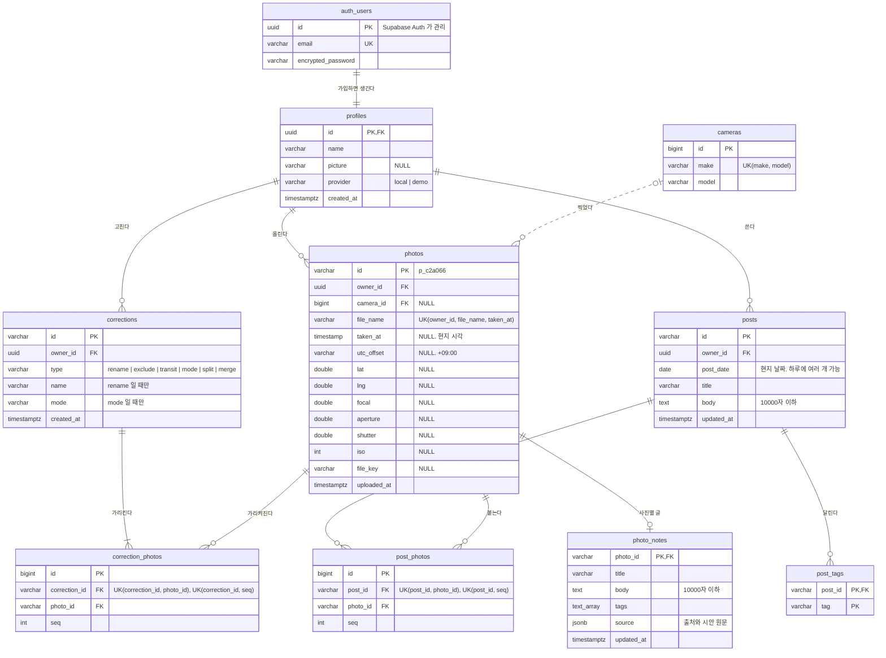

# ERD

프론트엔드 `src/data/seed/<인물>.json`의 모양(`user`·`photos`·`corrections`·`posts`)에서 출발해 BCNF까지 정규화했습니다. 실제 스키마의 기준은 `supabase/migrations/`의 SQL입니다. 리뷰용 그림은 [FigJam](https://www.figma.com/board/9VgKMorlVFMOaXIn6jjQ3X)의 "ERD v2"입니다(Spring 서버 시절 그림이라 `users`가 `profiles`·`auth.users`로 나뉜 것은 반영되지 않았습니다).

## 정한 것과 이유

- **지점·여행·이동 구간은 저장하지 않는다.** 프론트엔드가 사진과 보정으로 매번 계산합니다. 지점·여행 ID는 첫 사진 ID라 사진이 바뀌면 달라집니다.
- **사진·보정·글 ID는 프론트가 만든 문자열(`p_xxxxxx` 등)을 그대로 받는다.** 사진은 브라우저에서 먼저 읽고(IndexedDB) 나중에 올라오므로, 서버가 새로 매기면 보정·글이 가리키는 ID가 어긋납니다.
- **계정은 Supabase Auth가 갖는다.** 이메일·비밀번호는 `auth.users`에 두고 `profiles`에는 화면에 보일 정보만 둡니다. 그래서 `owner_id`는 seed의 `u_seojin`이 아니라 uuid입니다. Google 로그인 대신 이메일·비밀번호인 이유는 배포 서버의 데모 데이터를 보려고 실제 계정을 거치지 않게 하려는 것입니다.
- **`provider`는 가입자가 못 바꾼다.** 가입 트리거가 사용자가 고칠 수 없는 `app_metadata.danyeo_provider`에서 읽고, `profiles`는 이름·사진 칸만 수정 권한을 줍니다. 데모 계정도 쓰기를 허용하고 초기화하지 않습니다.
- **`time_uncertain` 칸은 두지 않는다.** seed와 업로드 예시 전부에서 `utc_offset`이 비어 있을 때만 참이라, 칸으로 두면 같은 사실을 두 번 저장하게 됩니다(3NF). `my_data()`가 읽을 때 계산합니다.
- **카메라는 `cameras`로 분리한다.** 모델이 제조사를 결정합니다(`iPhone 13 → Apple`, BCNF). 초점 거리·조리개·셔터·ISO는 사진마다 다른 촬영 설정이라 `photos`에 둡니다.
- **다대다는 중간 엔티티(`correction_photos`·`post_photos`)로 푼다.** `id`를 PK로 두고, 원래 키 `(부모, photo_id)`와 순서 `(부모, seq)`는 UK로 겁니다. 태그는 다른 엔티티를 잇지 않는 값이라 `post_tags`의 `(post_id, tag)`가 PK입니다.
- **같은 사진은 `(owner_id, file_name, taken_at)`으로 판단한다.** 같은 사진을 다시 올리면 건너뜁니다. 촬영 시각이 없는 사진끼리도 같은 것으로 보도록 `nulls not distinct`를 씁니다.
- **`corrections`는 한 테이블에 둔다.** `name`·`mode`는 종류에 따라 비지만 종속 관계 문제는 아닙니다. 종류별 테이블로 나누면 정규화 이득 없이 테이블만 6개가 됩니다. 종류와 칸이 어긋나지 않게 check 제약을 겁니다.
- **`type`·`mode` 값은 소문자.** 프론트엔드가 테이블에 바로 붙으므로 seed JSON 값을 그대로 씁니다.
- **예약어를 피했다.** `offset` → `utc_offset`, `date` → `post_date`.
- **권한은 RLS로만 건다.** 모든 테이블이 본인 행만 읽고 쓰고, 중간 엔티티는 부모와 사진이 둘 다 본인 것일 때만 잇습니다. `cameras`만 모두가 읽고 추가합니다.
